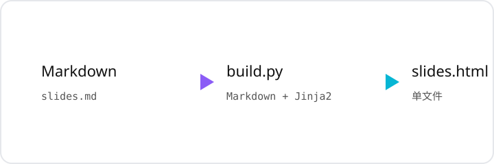

# Markdown → 单文件 HTML 幻灯片模板

一个仿「jyywiki 讲义」风格的幻灯片实现：**写 Markdown，一条命令生成一个可以直接双击打开的 HTML 文件**。没有 npm、没有构建服务器、不依赖 reveal.js / Marp。

- 任意窗口尺寸、任意分辨率都不裁剪、不出现滚动条
- 公式（MathJax）、代码高亮（highlight.js）、表格、图片开箱即用
- 所有幻灯片数据内联在一个 HTML 里，方便分发、离线演示（需联网加载 CDN 依赖，见 FAQ）



---

## 目录结构

```
slides-template/
├── build.py          # 构建脚本：Markdown → HTML
├── slides.html       # Jinja2 模板（含全部 CSS 与约 250 行 JS 引擎）
├── example.md        # 示例讲义（同时也是语法说明）
├── requirements.txt  # Python 依赖
├── assets/
│   └── demo.svg      # 示例图片
└── README.md         # 本文件
```

最终产物只有一个 `.html` 文件，模板和源文件都不需要随产物分发。

---

## 环境准备

需要 Python 3.9+：

```bash
cd slides-template
python3 -m venv .venv
source .venv/bin/activate          # Windows: .venv\Scripts\activate
pip install -r requirements.txt
```

依赖只有两个：`Markdown`（把 Markdown 转 HTML）和 `Jinja2`（把内容注入模板）。

不想用虚拟环境也可以直接：

```bash
pip3 install --user -r requirements.txt
```

---

## 快速开始

> 下面的命令都要在 `slides-template/` 目录里执行，并且使用虚拟环境里的 Python。
> 如果看到 `can't open file '.../build.py'`，说明当前目录不对；如果提示缺少
> `markdown` / `jinja2`，说明用的是系统 Python 而不是 `.venv` 里的 Python。

1. 复制一份 `example.md`，改名为你的讲义，例如 `lecture01.md`；
2. 用单独一行的 `---` 分页；
3. 构建：

```bash
python3 build.py lecture01.md -o lecture01.html -t "第 1 讲 · 课程名"
```

4. 双击 `lecture01.html`，或：

```bash
python3 build.py lecture01.md -t "第 1 讲" --open
```

构建成功会输出页数和文件大小：

```
✓ 生成 /path/to/lecture01.html
  12 页，96.4 KB
```

想先看看效果，可以直接构建自带示例：

```bash
python3 build.py example.md -o example.html --open
```

---

## Markdown 写法约定

### 1. 分页

**单独一行**的三个减号是分页符，前后空行可有可无：

```markdown
# 第一页标题

正文……

---

# 第二页标题

正文……
```

> `---` 在 Markdown 里本来是「分隔线」。在这个模板里它被构建脚本提前截获，用来分页，所以讲义里不会出现 `<hr>`。确实需要横线时，直接写 `<hr>`。

代码围栏（```` ``` ````）里的 `---` 不会被误当成分页：

````markdown
```yaml
---
key: value
---
```
````

### 2. 页首标题 → 顶部标题条

每页**开头第一个 `<h1>`**（也就是第一个 `# 标题`）会被 JS 移到顶部标题条里：

- 标题条横跨整屏、始终顶格，**不参与正文的等比缩放**；
- 标题字号由 JS 二分查找，最多占屏幕 30% 高度，长标题也不会挤爆正文；
- 标题里的 `**加粗**` 在深色标题条上会自动变成浅红色。

一页里如果还有第二个 `#`，它会留在正文中按普通大标题渲染。

### 3. 代码块

````markdown
```python
def hello():
    print("Hello, slides!")
```
````

语言名会保留为 `<code class="language-python">`，由浏览器端的 highlight.js 高亮。支持的语言见 [highlight.js 文档](https://highlightjs.org/)。不写语言也可以，只是没有配色。

### 4. 公式

行内公式用单个美元符号，块级公式用双美元符号：

```markdown
行内：$e^{i\pi} + 1 = 0$

块级：

$$
\int_0^\infty e^{-x^2}\,\mathrm{d}x = \frac{\sqrt{\pi}}{2}
$$
```

构建脚本会在交给 Markdown 解析器之前**先把公式替换成占位符**，避免 `_`、`^`、`*` 被当成强调语法，渲染完再还原。代码块里的 `$` 不会被误保护。

### 5. 图片

```markdown

```

- **相对路径**的本地图片会被自动转成 base64 内联进 HTML（默认行为），产物可以单独拷走；
- `http://`、`https://`、`data:` 开头的地址原样保留；
- 找不到的图片会打印警告，并保留原路径，页面里会显示裂图；
- 同一页有多张图片时，它们会均分正文的可用高度，不会把页面顶爆；
- 不想内联时加 `--no-inline-images`，产物体积更小，但需要连同图片目录一起分发。

### 6. 表格、引用、列表

就是标准 Markdown：

```markdown
> 引用

| A | B |
| --- | --- |
| 1 | 2 |
```

### 7. 标记 AI 补充内容（可选）

模板里带了一个 `.aigc` 样式，用来标注 AI 生成/补充的段落，会显示一个紫色小星光图标和淡紫虚线框：

```html
<span class="aigc">这段是 AI 补充的（<a href="...">来源</a>）</span>
```

不需要可以删掉 `slides.html` 里对应的 CSS。

---

## 命令行参数

```bash
python3 build.py <source.md> [选项]
```


| 参数                 | 说明                                    |
| -------------------- | --------------------------------------- |
| `source`             | 必填，Markdown 源文件                   |
| `-o, --output`       | 输出 HTML 路径，默认与源文件同名同目录  |
| `-t, --title`        | 浏览器标签页标题，默认取源文件名        |
| `--template`         | 指定其他模板，默认同目录的`slides.html` |
| `--no-inline-images` | 不内联本地图片，保留相对路径            |
| `--open`             | 构建完成后用默认浏览器打开              |
| `-h, --help`         | 查看帮助                                |

示例：

```bash
# 输出到 build/lecture01.html
python3 build.py lecture01.md -o build/lecture01.html

# 不内联图片，便于用 CDN / 图床
python3 build.py lecture01.md --no-inline-images

# 用自定义模板（改配色、改动画）
python3 build.py lecture01.md --template my-theme.html
```

---

## 演示时的键盘快捷键


| 按键                                         | 作用                                                     |
| -------------------------------------------- | -------------------------------------------------------- |
| `Space` `→` `↓` `j` `l` `Enter` `PageDown` | 下一页                                                   |
| `←` `↑` `h` `k` `Backspace` `PageUp`       | 上一页                                                   |
| `Home` / `End`                               | 首页 / 末页                                              |
| `f`                                          | 进入/退出全屏                                            |
| `q`                                          | 尝试关闭窗口（多数浏览器会拦截，仅对脚本打开的窗口有效） |

翻页动画是两页首尾相接的横向平移：新页从翻页方向推入，旧页同速退出，全程铺满屏幕，不会闪白底。

---

## 自定义外观

所有颜色、字体、间距都集中在 `slides.html` 顶部的 `:root` 变量里：

```css
:root {
  --bg: #ffffff;                 /* 页面底色 */
  --fg: #111111;                 /* 正文颜色 */
  --muted: #555555;              /* 次要文字 */
  --red: #b91c1c;                /* 加粗强调色 */
  --title-bg: rgba(59,7,100,.72);/* 标题条玻璃底色 */
  --title-fg: #ffffff;
  --title-accent: #fca5a5;       /* 标题条里的加粗 */
  --font: system-ui, "PingFang SC", ...;
  --mono: "JetBrains Mono", ...;
  --base-font: clamp(20px, 3.25vh, 35px);  /* 正文基准字号 */
  --transition: .28s cubic-bezier(.22,.61,.36,1); /* 翻页时长/缓动 */
}
```

常见改法：

- **换成深色主题**：`--bg: #0f172a; --fg: #e5e7eb; --code-bg: #111827; --quote-bg: #1f2937;`，同时把 `pre` 边框色改深，highlight.js 主题换成 `github-dark.min.css`。
- **字号更大/更小**：只改 `--base-font` 的上下限和中值。注意这是「基准字号」，内容溢出时仍会整体缩放。
- **换字体**：`--font` 和 `--mono` 按顺序回退，中文字体建议保留 `PingFang SC` / `Noto Sans CJK SC`。
- **翻页更快**：调小 `--transition`，例如 `.18s`。

代码高亮的主题在 `<head>` 的 `<link rel="stylesheet">` 里换，例如：

```html
<link rel="stylesheet"
      href="https://cdn.jsdelivr.net/gh/highlightjs/cdn-release@11.10.0/build/styles/github-dark.min.css">
```

---


## 部署

产物是纯静态 HTML，放到任何地方都能用：

```bash
# 本地直接打开
open lecture01.html

# 本地起一个静态服务器（避免个别浏览器对 file:// 的限制）
python3 -m http.server 8000

# GitHub Pages：把 html 放到仓库根目录或 docs/ 下，开启 Pages 即可
```

如果图片都用默认的 base64 内联，**单个 HTML 文件本身就是完整产物**，不需要带 `assets/` 目录。

---


## 依赖与许可

- [Python-Markdown](https://python-markdown.github.io/) — BSD
- [Jinja2](https://jinja.palletsprojects.com/) — BSD
- [MathJax](https://www.mathjax.org/) — Apache-2.0
- [highlight.js](https://highlightjs.org/) — BSD-3-Clause

本模板代码可自由用于课程讲义、技术分享等场景。

---

## 参考

版式与自适应思路参考了南京大学蒋炎岩老师（jyy）公开在 [jyywiki.cn](https://jyywiki.cn/) 上的课程讲义实现，代码为本模板重新编写。
