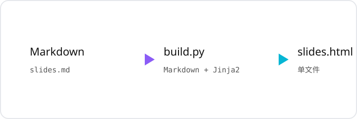

# 用 Markdown 做幻灯片

## 一个文件，零依赖，全分辨率

- 每页就是一个固定画布，**内容永远不会被裁剪**
- 内容多了整页等比缩小，内容少了保持原字号
- 支持公式、代码高亮、表格、图片和 HTML 片段

> 设计目标：让「写讲义」变成「写 Markdown」。

---

# 分页规则

## 三个减号独占一行就是分页

```markdown
第一页内容

---

第二页内容
```

- 代码围栏里的 `---` 不会被误切（构建脚本会跳过围栏）
- 每页开头第一个 `#` 标题会被提取成顶部标题条
- 一页里的后续 `#` 仍然按普通大标题渲染

---

# 代码与公式

## 代码块由 highlight.js 在浏览器端高亮

```python
def fib(n: int) -> int:
    a, b = 0, 1
    for _ in range(n):
        a, b = b, a + b
    return a
```

行内代码 `transform: scale(...)` 也不会被公式保护逻辑破坏。

## 公式交给 MathJax

行内公式 $e^{i\pi} + 1 = 0$，块级公式：

$$
\int_{0}^{\infty} e^{-x^{2}}\,\mathrm{d}x = \frac{\sqrt{\pi}}{2}
$$

---

# 表格、图片与其他

## 表格

| 方案 | 是否裁剪 | 字号一致性 | 适合场景 |
| --- | --- | --- | --- |
| 固定字号 + 滚动 | 否 | 高 | 网页阅读 |
| 整页等比缩放 | 否 | 低 | 演示 / 投影 |
| 手动分页 | 是 | 高 | 传统 PPT |

## 本地图片会被自动内联为 base64



图片会均分正文可用高度，多图也不会把页面顶爆。
